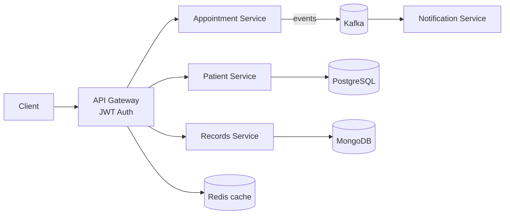
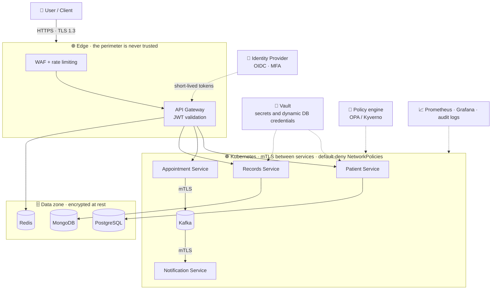
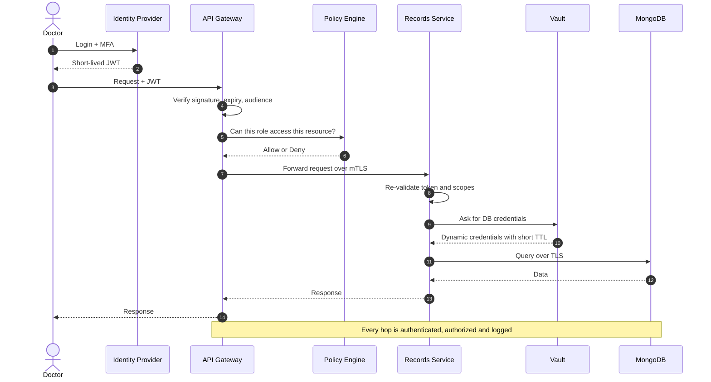
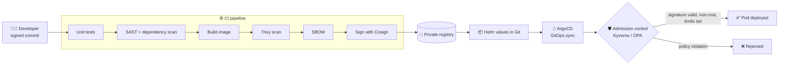

# Mohamed Benzraidi

### Software Engineer | Cloud & DevOps | AI/ML

**Building reliable software, automating infrastructure, and exploring intelligent systems.**

  
  
  

## 👨‍💻 About Me

I'm a final-year Software Engineering student at **ENSA Al Hoceima, Morocco**, with a strong interest in software architecture, cloud infrastructure, DevOps, and artificial intelligence.

I enjoy designing and building scalable applications, automating infrastructure, and exploring how software engineering and machine learning can solve real-world problems.

- 🎓 Engineering student in Software Engineering — ENSAH
- ☁️ Interested in Cloud Computing, DevOps & Infrastructure Automation
- 💻 Experienced with Java, Spring Boot, Python and modern software architectures
- 🤖 Exploring Machine Learning and Deep Learning
- 🏢 Former Cloud & DevOps Intern at STMicroelectronics
- 🏢 Former Software Engineering Intern at DGM
- 🎯 Looking for a **PFE Internship — 2027**

---

## ⚡ At a Glance

| 🧩 Projects | 🧱 Microservices | 🐳 Containers | ☸️ K8s deployments | 🧠 ML models | 🔁 CI/CD pipelines |
|:-:|:-:|:-:|:-:|:-:|:-:|
| **4+** | **8+** | **15+** | **Helm + GitOps** | **BiLSTM / LLM** | **Automated** |

| 📝 Lines of code | 🧪 Test coverage | 📦 Commits | ☁️ Cloud | 🔐 Security |
|:-:|:-:|:-:|:-:|:-:|
| **40K+** | **70%+** (core services) | **1,000+** | **AWS** | **JWT · CIS hardening** |

> 💡 Numbers are indicative of my main repositories and grow with every project.

---

## 🛠️ Technical Skills

### Programming Languages

  

### Backend & Software Engineering

  

### Frontend Development

  

### Cloud, DevOps & Infrastructure

  

### AI & Machine Learning

  

### Tools & Technologies

  

---

## 🚀 Featured Projects

### ☁️ MediCloud — Distributed Healthcare Platform

> A cloud-native healthcare platform where every business capability (patients, appointments, records, notifications) is an independent, observable and deployable microservice.

| 📝 Lines of code | 🧱 Services | 🔌 REST endpoints | 🐳 Docker images | 📊 Dashboards |
|:-:|:-:|:-:|:-:|:-:|
| **~20K** | **8+** | **60+** | **10+** | **5+** |

**What makes it solid**
- 🧭 **API Gateway & service discovery** with Spring Cloud for a single, secured entry point
- 🔐 **Stateless JWT authentication** and role-based access control
- 📨 **Event-driven communication** with Kafka for loose coupling and resilience
- ⚡ **Redis caching** to cut latency on hot read paths
- ☸️ **Kubernetes + Helm** packaging, **ArgoCD** GitOps continuous delivery
- 📈 **Prometheus & Grafana** for metrics, dashboards and alerting

#### 🛡️ Zero Trust Security Design

Healthcare data is sensitive, so MediCloud follows one rule: **never trust, always verify**. No request is trusted because of where it comes from. Every hop is authenticated, authorized and logged.

| Zero Trust pillar | Mechanism | Status |
|---|---|:-:|
| Identity | JWT authentication, role-based access | ✅ In place |
| Edge | API Gateway as single secured entry point | ✅ In place |
| Delivery | GitOps with ArgoCD, Helm | ✅ In place |
| Observability | Prometheus and Grafana | ✅ In place |
| Short-lived tokens, MFA | OIDC identity provider | 🛠️ Roadmap |
| Service-to-service trust | mTLS through a service mesh | 🛠️ Roadmap |
| Network isolation | Default-deny Kubernetes NetworkPolicies | 🛠️ Roadmap |
| Secrets | Vault with dynamic DB credentials | 🛠️ Roadmap |
| Policy as code | OPA / Kyverno admission and authorization | 🛠️ Roadmap |
| Supply chain | Trivy scan, SBOM, Cosign image signing | 🛠️ Roadmap |

**1. Zero Trust architecture: every layer verifies**

**2. Request lifecycle: authenticate and authorize at every hop**

**3. Zero Trust delivery: only verified code reaches the cluster**

🔗 [View Repository](https://github.com/mohamedbenzraidi/medicloud)

---

### 🧠 EarlyAlert ICU — AI-Based Patient Deterioration Prediction

> A deep learning system that analyses sequences of vital signs and lab values to flag ICU patients at risk **before** their condition deteriorates.

| 📝 Lines of code | 🧬 Architecture | 📈 Input | 🎯 Output | 🖥️ Interface |
|:-:|:-:|:-:|:-:|:-:|
| **~5K** | **BiLSTM + Attention** | **Time-series** | **Risk score** | **Streamlit** |

**Highlights**
- 🔁 **Bidirectional LSTM** to capture temporal dependencies in both directions
- 🎯 **Attention mechanism** to highlight which time steps drive each prediction (explainability)
- 🧹 Full pipeline: preprocessing, imputation, windowing, training, evaluation
- 📊 Metrics tracked: **AUROC, precision/recall, F1** with class-imbalance handling
- 🖥️ **Interactive dashboard** to monitor patients and visualise risk over time

---

### 🏗️ Infrastructure Automation & Provisioning

> Everything as code: from a bare server to a hardened, reproducible environment, with no manual clicks.

| 📝 IaC lines | 🧩 Terraform modules | 📜 Ansible roles | 🖼️ Golden images | ⏱️ Provisioning |
|:-:|:-:|:-:|:-:|:-:|
| **~6K** | **10+** | **10+** | **CIS-hardened Ubuntu** | **Minutes, not hours** |

**Highlights**
- 🏗️ **Terraform** modules for reproducible AWS environments
- 🖼️ **Packer** golden images hardened with **CIS benchmarks**
- 🔧 **Ansible** roles for configuration management and idempotent setup
- 🖧 **Redfish** API for automated bare-metal server provisioning
- ♻️ Same code, same result: dev, test and prod stay consistent

---

### 🤖 Medical AI & RAG

> A medical knowledge assistant that answers questions grounded in trusted documents instead of guessing.

| 📝 Lines of code | 🧠 Model | ⚙️ Fine-tuning | 🔎 Retrieval |
|:-:|:-:|:-:|:-:|
| **~3K** | **BioMistral** | **QLoRA (4-bit)** | **Vector search** |

**Highlights**
- 🧬 Domain-specific LLM fine-tuned efficiently with **QLoRA** on limited GPU memory
- 📚 **Retrieval-Augmented Generation** to ground answers in source documents and reduce hallucinations
- 🔎 Embeddings + vector database for fast semantic search

---

## 🧭 What I Bring

- ✅ **Architecture mindset**: I design systems that scale and stay maintainable
- ✅ **End-to-end ownership**: from code to container to cluster to monitoring
- ✅ **Automation first**: if I do it twice, I script it
- ✅ **Security aware**: JWT, hardened images, CIS recommendations
- ✅ **Data & AI curiosity**: deep learning and LLMs applied to healthcare

---

## 🎓 Education & Certifications

### Education
**École Nationale des Sciences Appliquées d'Al Hoceima (ENSAH)**

Engineering Degree — Software Engineering  
2022 – 2027 (Expected)

---

## 📊 GitHub Statistics

---

## 🌐 Let's Connect

I'm always interested in discussing software engineering, cloud technologies, DevOps, AI, and innovative projects.

  

**Building today. Engineering tomorrow.**

