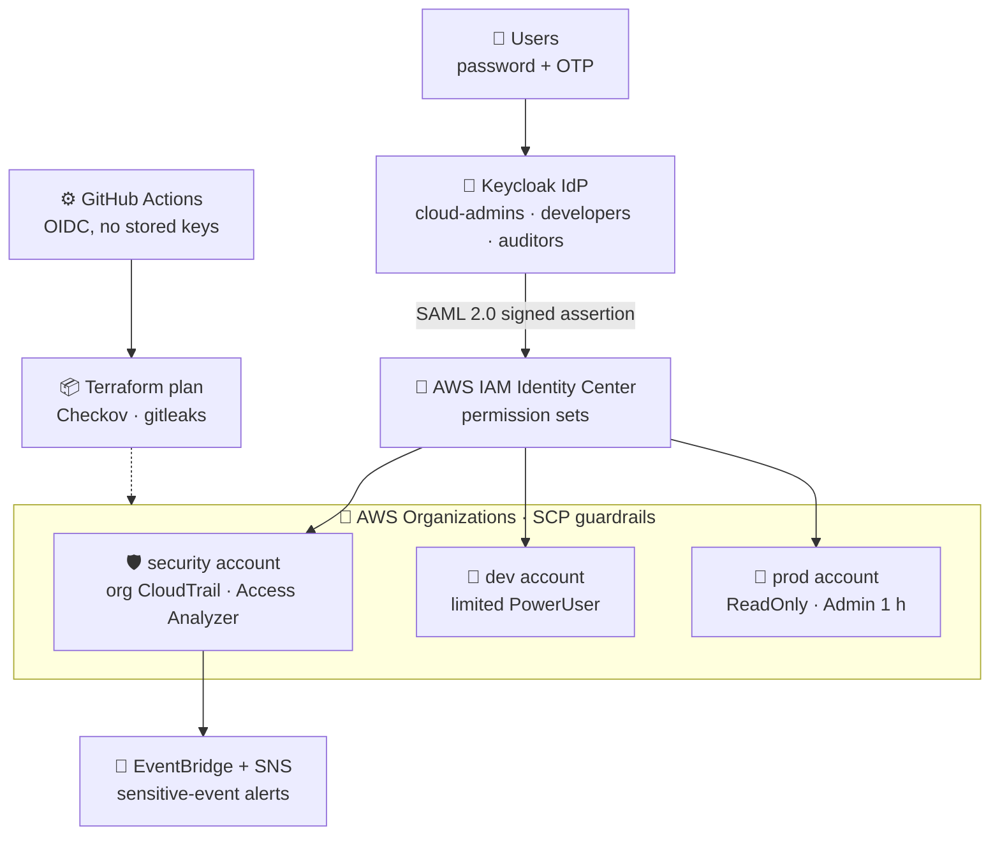
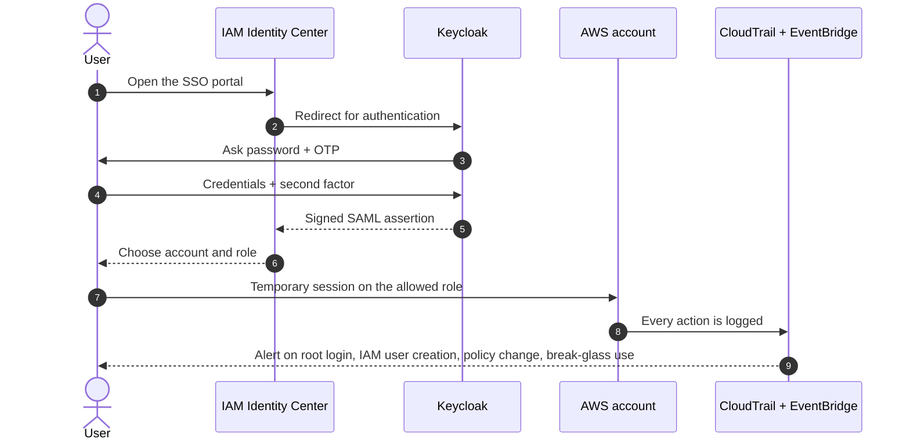
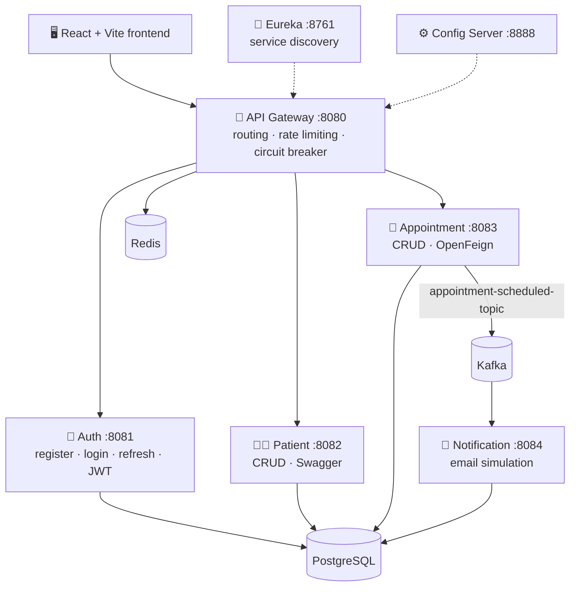
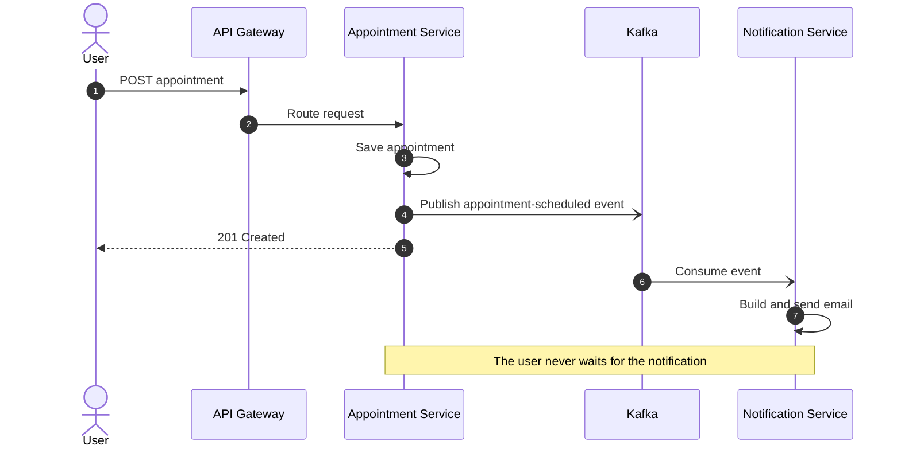

# Mohamed Benzraidi

### Software Engineer | Cloud & DevOps | AI/ML

**Building reliable software, automating infrastructure, and exploring intelligent systems.**

  
  
  

## 👨‍💻 About Me

I'm a final-year Software Engineering student at **ENSA Al Hoceima, Morocco**, with a strong interest in software architecture, cloud infrastructure, DevOps, and artificial intelligence.

I enjoy designing and building scalable applications, automating infrastructure, and exploring how software engineering and machine learning can solve real-world problems.

- 🎓 Engineering student in Software Engineering — ENSAH
- ☁️ Interested in Cloud Computing, DevOps & Infrastructure Automation
- 💻 Experienced with Java, Spring Boot, Python and modern software architectures
- 🤖 Exploring Machine Learning and Deep Learning
- 🏢 Former Cloud & DevOps Intern at STMicroelectronics
- 🏢 Former Software Engineering Intern at DGM
- 🎯 Looking for a **PFE Internship — 2027**

---

## ⚡ At a Glance

| 🔐 Cloud IAM Zero Trust | 🏥 MediCloud |
|:--|:--|
| **3** AWS accounts federated through one IdP | **7** Spring Boot modules (4 business services) |
| **6** Terraform modules + bootstrap | **1** event-driven flow with Kafka |
| **4** organization-level guardrails (SCP) | **Redis** rate limiting + circuit breaker |
| **11** documented test scenarios | **React** frontend served through the gateway |

---

## 🛠️ Technical Skills

### Programming Languages

  

### Backend & Software Engineering

  

### Frontend Development

  

### Cloud, DevOps & Infrastructure

  

### AI & Machine Learning

  

### Tools & Technologies

  

---

## 🚀 Featured Projects

### 🔐 Cloud IAM Zero Trust — Multi-Account AWS SSO Federation

> One identity provider, three AWS accounts: SAML single sign-on, mandatory MFA, least privilege, organization-wide guardrails, sensitive-event detection, and everything deployed as code.

| 🏢 AWS accounts | 🧩 Terraform modules | 🚫 SCP guardrails | 🧪 Test scenarios | 🗝️ Human access keys |
|:-:|:-:|:-:|:-:|:-:|
| **3** (security, dev, prod) | **6** + bootstrap | **4** | **11** | **0** |

**Architecture**

**Authentication flow**

**What makes it solid**
- 🔑 **Single identity per person**, no local IAM users and no long-lived keys for humans (one documented break-glass exception)
- 🛂 **Role-based access**: groups → permission sets → accounts, with a 1 h session for admins
- 🎯 **Least privilege driven by real activity**: a broad starting policy replaced by one generated from IAM Access Analyzer
- 🚧 **Organization guardrails (SCP)**: protect CloudTrail, forbid root usage, IAM users and access keys, restrict allowed regions
- 🚨 **Detection**: EventBridge → SNS alerts on sensitive events
- 🤖 **100% Infrastructure as Code**: Terraform with encrypted S3 state and native locking, CI with `fmt`, `validate`, Checkov, gitleaks and `plan`
- 📊 **Measurable outcome**: Prowler (CIS AWS) score before and after

---

### 🏥 MediCloud — Cloud-Native Medical Platform

> A microservices platform for patient and appointment management, built with Spring Boot 3 and Spring Cloud, where booking an appointment triggers an asynchronous notification through Kafka.

| 🧱 Spring modules | 💼 Business services | 📨 Kafka flow | 🛡️ Resilience | 📘 API docs |
|:-:|:-:|:-:|:-:|:-:|
| **7** | **4** (auth, patient, appointment, notification) | **1** appointment → notification | **Rate limiting + circuit breaker** | **Swagger** |

**Architecture**

**Event-driven flow**

**Engineering status**

| Area | Status |
|---|:-:|
| Service discovery (Eureka), Auth with JWT, Appointment + Kafka producer | ✅ Done |
| API Gateway with Redis rate limiting and circuit breaker | ✅ Done |
| React frontend, Docker Compose, Kubernetes manifests (Deployments, Ingress, HPA) | ✅ Done |
| Gateway routing alignment and JWT enforcement on Patient service | 🚧 In progress |
| Helm charts, ArgoCD, Prometheus and Grafana | 🛠️ Roadmap |
| Testcontainers and higher test coverage, real email/SMS provider | 🛠️ Roadmap |

🔗 [View Repository](https://github.com/mohamedbenzraidi/medicloud)

---

## 🧭 What I Bring

- ✅ **Architecture mindset**: I design systems that scale and stay maintainable
- ✅ **End-to-end ownership**: from code to container to cloud account
- ✅ **Automation first**: if I do it twice, I script it
- ✅ **Security by design**: SAML SSO, MFA, least privilege, organization guardrails, JWT
- ✅ **Honest engineering**: I document limits, trade-offs and what is still on the roadmap

---

## 🎓 Education

**École Nationale des Sciences Appliquées d'Al Hoceima (ENSAH)**

Engineering Degree — Software Engineering  
2022 – 2027 (Expected)

---

## 📊 GitHub Statistics

---

## 🌐 Let's Connect

I'm always interested in discussing software engineering, cloud technologies, DevOps, AI, and innovative projects.

  

**Building today. Engineering tomorrow.**

